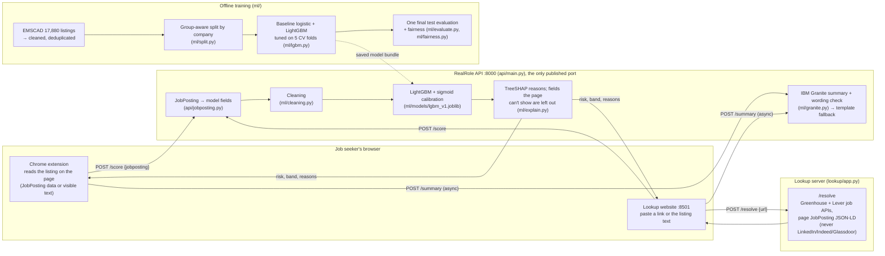

# RealRole architecture

RealRole checks a job listing for signs of a scam. A predictive model (LightGBM) scores the listing and explains its score field by field. IBM Granite turns those reasons into one plain sentence. The browser extension and the lookup website show the result.

## Components

| Part | Code | What it does |
|---|---|---|
| Extension | `extension/` | Reads the listing on Greenhouse, Lever, Workday and LinkedIn pages. Shows a badge ("74% scam risk · High") and a "Why?" side panel. Sends only the listing's public content. |
| Lookup site | `lookup/` | Paste a link (fetched through the Greenhouse/Lever job APIs or the page's JobPosting data) or paste the text. |
| API | `api/main.py` | `POST /score` (about 150 ms), `POST /summary` (Granite, about 20 s on a laptop CPU), `GET /health`, `GET /demo`. Standard library only. Request bodies are never logged. |
| Scoring | `ml/run.py`, `ml/explain.py` | Cleaning → features → LightGBM → calibrated probability → per-field contributions. |
| Generative | `ml/granite.py` | Granite writes one sentence from the reasons only. It runs locally via `transformers`, or through watsonx.ai on LinuxONE. A wording check rejects accusations and speculation and falls back to a template. |
| Training and evaluation | `ml/` | Cleaning, group-aware split, baseline + LightGBM, the one final test, fairness. See `ml/README.md` and `docs/model-card.md`. |

## IBM labs used

| Lab | Where |
|---|---|
| **Predictive AI, hybrid multi-model** | Two predictive models (logistic baseline, LightGBM) compared on the same group-aware CV. The calibrated LightGBM serves, with TreeSHAP explanations. |
| **Predictive AI + Generative AI** | LightGBM's score and reasons are the only facts given to IBM Granite, which writes the summary. Granite never changes the score. |

## Deployment on LinuxONE (to do, Workstream C)

1. Install `ml/requirements.txt` on s390x and **check LightGBM builds there**. If it doesn't, retrain with scikit-learn's `HistGradientBoostingClassifier` on SVD-reduced text.
2. Copy `ml/models/lgbm_v1.joblib`, or retrain on the box with `python -m ml.run train --model lgbm`.
3. Run `api/main.py` in its own container, the only published port. For Granite, set `RR_GRANITE=watsonx` plus the watsonx credentials, since PyTorch may not install on s390x.
4. Point `extension/config.js` `API_URL` at the server (through the SSH tunnel for the demo).
5. Take screenshots: `uname -m` (s390x), the container list, a `curl /health` and a `curl /score`.
